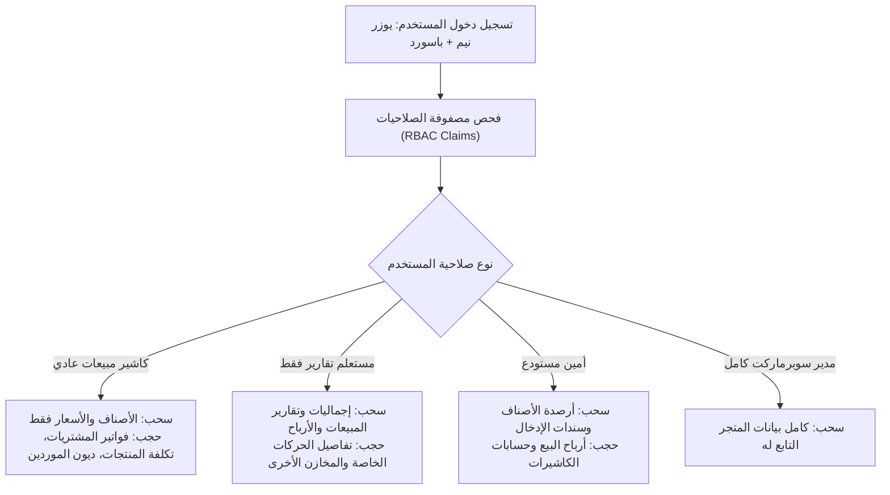

# NEXA POS -- Hybrid Offline-First SaaS & Multi-Tenancy Architecture
## وثيقة المعمارية الهندسية الشاملة للتحول السحابي الهجين وحماية البيانات لـ 1,000,000 مستخدم
### وثيقة التصميم المعماري للـ 100 عام القادمة (Senior / Principal Software Engineering Blueprint)

---

## الفهرس العام (Table of Contents)
1. [الرؤية الهندسية وفلسفة النظام الهجين (System Vision & Offline-First Philosophy)](#1-الرؤية-الهندسية-وفلسفة-النظام-الهجين)
2. [المعمارية العامة وطوبولوجيا النظام (System Topology & High-Level Architecture)](#2-المعمارية-العامة-وطوبولوجيا-النظام)
3. [الجدار العازل الفاصل بين الأونلاين والأوفلاين (The Fault-Isolation Partition Wall)](#3-الجدار-العازل-الفاصل-بين-الأونلاين-والأوفلاين)
4. [معمارية قواعد البيانات وعزل المستأجرين لمليون عميل (Multi-Tenancy at 1,000,000 Scale)](#4-معمارية-قواعد-البيانات-وعزل-المستأجرين-لمليون-عميل)
5. [محرك المزامنة التفاضلية ثنائية الاتجاه (Bi-Directional Delta Synchronization Engine)](#5-محرك-المزامنة-التفاضلية-ثنائية-الاتجاه)
6. [التعامل مع انقطاع التيار والشبكة وتضارب البيانات (Outage Resilience & Conflict Resolution)](#6-التعامل-مع-انقطاع-التيار-والشبكة-وتضارب-البيانات)
7. [تعدد الفروع والصلاحيات المنعزلة ومبدأ الامتياز الأقل (Multi-Branch & Scoped RBAC)](#7-تعدد-الفروع-والصلاحيات-المنعزلة-ومبدأ-الامتياز-الأقل)
8. [منظومة التراخيص الهجينة وربط الأجهزة بالداشبورد (Dual-Mode Licensing & Device Fleet)](#8-منظومة-التراخيص-الهجينة-وربط-الأجهزة-بالداشبورد)
9. [لوحة التحكم السحابية المركزية لمالك النظام (SaaS Super-Admin Dashboard)](#9-لوحة-التحكم-السحابية-المركزية-لمالك-النظام)
10. [مسار الترقية السلس بدون أي فقدان لبيانات العملاء القدامى (Zero-Data-Loss Migration Path)](#10-مسار-الترقية-السلس-بدون-أي-فقدان-لبيانات-العملاء-القدامى)
11. [مصفوفة الأمان والأداء والمراقبة (Security, Performance & Observability Matrix)](#11-مصفوفة-الأمان-والأداء-والمراقبة)
12. [خطة التنفيذ المرحلية من الألف إلى الياء (Phased Implementation Roadmap)](#12-خطة-التنفيذ-المرحلية-من-الألف-إلى-الياء)

---

## 1. الرؤية الهندسية وفلسفة النظام الهجين

### 1.1 المبدأ الجوهري: "السرعة المحلية والاستقلالية التامة مع قوة السحابة" (Local-First Speed, Cloud Scale)
في أنظمة نقاط البيع (POS) وتجارة التجزئة، يُعتبر توقف الكاشير عن إصدار الفواتير أو بطء استجابته بمثابة كارثة تجارية تؤدي إلى خسارة المبيعات وازدحام طوابير الزبائن. 
إن الفلسفة التي يتبناها كبار مهندسي البرمجيات (Senior / Staff Architects) ترفض تماماً جعل تطبيق الكاشير معتمداً بصورة مباشرة أو متزامنة (Synchronous) على استجابة خادم سحابي عن بُعد. 

```
                                    ┌────────────────────────────────────────────────────────┐
                                    │                     المبدأ الحاكم                      │
                                    │     تطبيق الكاشير على الأرض يملك قاعدة بياناته الخاصة    │
                                    │      (SQLite WAL) ويعمل محلياً بسرعة 0ms بدون انتظار    │
                                    │      والسحابة (Cloud) تعمل كقناة مزامنة غير متزامنة     │
                                    │         (Asynchronous Background Event Stream)         │
                                    └────────────────────────────────────────────────────────┘
```

### 1.2 قواعد التصميم للـ 100 عام القادمة (The 100-Year Architectural Durability Rules)
1. **الاستقلالية التامة (Local Autonomy):** كل جهاز كاشير هو Master محلي على بياناته، قادر على تشغيل البيع، المرتجعات، حساب الضرائب، طباعة الإيصالات، وإغلاق الوردية حتى لو انقطع الإنترنت لعدة أشهر.
2. **العزل الفيزيائي والمنطقي (Zero Blast Radius):** سقوط الخادم المركزي، تعرضه لهجمات حجب الخدمة (DDoS)، أو انقطاع كابلات الإنترنت الدولية، لا يؤثر بنسبة 0.001% على عمليات البيع داخل المتاجر.
3. **عدم إتلاف البيانات القديمة (Zero-Loss Invariant):** المتاجر التي تعمل حالياً بالنظام الأوفلاين وتحتوي أجهزتها على فواتير ومنتجات وحسابات عملاء، تُرقى للنسخة الهجينة باحتفاظ كامل وتلقائي بجميع بياناتها دون أي فقدان أو إعادة تهيئة.
4. **المرونة المطلقة في التراخيص (Dual Activation Elasticity):** إمكانية تفعيل النظام إما عبر السحابة فوراً (Online Handshake) أو عبر ملفات التشفير المستقلة (Air-Gapped `.nexalic` License) لمنشآت المناطق المعزولة، مع إمكانية التحول السلس بين النمطين في أي وقت.

---

## 2. المعمارية العامة وطوبولوجيا النظام

تعتمد البنية التحتية للنظام على نموذج **Hub-and-Spoke Event-Driven Architecture** المقسم إلى مستويين رئيسيين:

```mermaid
graph TB
    subgraph CloudControlPlane ["1. السحابة المركزية (Cloud SaaS Plane - Scaled for 1M Tenants)"]
        EdgeProxy["Cloudflare CDN / Anycast Edge Proxy + DDoS Guard"]
        API_Gateway["Kong / Nginx Reverse Proxy & Rate Limiter"]
        Auth_Service["Auth & License Service (Ed25519 JWT / Claims)"]
        Sync_Ingress["Delta Sync Ingress Service (Go / Node.js Cluster)"]
        SuperAdmin_UI["Super-Admin Control Dashboard (Web App)"]
        Message_Bus["Kafka / Redis Streams (Partitioned by Tenant_ID)"]
        
        subgraph CloudStorage ["تخزين البيانات السحابي الموزع"]
            Central_DB[("PostgreSQL Cluster + Citus Sharding / Tenant Schemas")]
            Redis_Cache[("Redis Cluster: Session, Quotas, Rate Limits")]
            S3_Buckets[("Cloudflare R2 / S3: Encrypted Daily Backups")]
        end
    end

    EdgeProxy --> API_Gateway
    API_Gateway --> Auth_Service
    API_Gateway --> Sync_Ingress
    API_Gateway --> SuperAdmin_UI
    Sync_Ingress --> Message_Bus
    Message_Bus --> Central_DB
    Auth_Service --> Redis_Cache

    subgraph StoreNetwork ["2. المتجر على الأرض (Store Local Infrastructure - Desktop .EXE)"]
        subgraph Machine1 ["جهاز كاشير رئيسي #1 (Local Master / SQLite)"]
            Electron1["NEXA Desktop App (.exe)"]
            LocalDB1[("SQLite DB (WAL Mode)")]
            SyncDaemon1["Local Sync Daemon (Background Worker)"]
            LocalLANServer["Local LAN Discovery / WebSockets (Port 18492)"]
        end

        subgraph Machine2 ["جهاز كاشير إضافي #2 (Local Client)"]
            Electron2["NEXA Desktop App (.exe)"]
            LocalDB2[("SQLite DB (Scoped)")]
            SyncDaemon2["Local Sync Daemon"]
        end

        subgraph Machine3 ["جهاز محاسب / مدير الفرع #3"]
            Electron3["NEXA Desktop App (.exe)"]
            LocalDB3[("SQLite DB (Audit & Reports)")]
            SyncDaemon3["Local Sync Daemon"]
        end
    end

    SyncDaemon1 <==> |"HTTPS Delta Sync (Push/Pull) / WebSocket"| Sync_Ingress
    SyncDaemon2 <==> |"HTTPS Delta Sync (Push/Pull) / WebSocket"| Sync_Ingress
    SyncDaemon3 <==> |"HTTPS Delta Sync (Push/Pull) / WebSocket"| Sync_Ingress
    
    LocalLANServer <---> |"Local P2P Real-time Sync (When Online on LAN)"| Electron2
    LocalLANServer <---> |"Local P2P Real-time Sync (When Online on LAN)"| Electron3
```



---

## 3. الجدار العازل الفاصل بين الأونلاين والأوفلاين

### 3.1 فصل المسارات التشغيلية (Architectural Decoupling)
يتم تطبيق نمط **Bulkheading & Circuit Breaking** لحماية وظائف النظام الأساسية:

| الوظيفة (Function) | التنفيذ في وضع الأوفلاين (Offline Path) | التنفيذ في وضع الأونلاين (Online Path) | الجدار العازل (Isolation Policy) |
|---|---|---|---|
| **إصدار الفاتورة وحفظها** | كتابة فورية ذرية في SQLite المحلية (`BEGIN IMMEDIATE TRANSACTION`). | نفس المسار المحلي فوراً + إضافة سجل في جدول `local_sync_outbox`. | **انفصال كامل 100%:** لا يوجد أي اتصال شبكي أثناء حركة الدفع وحفظ الفاتورة على الإطلاق. |
| **تحديث رصيد المخزون** | خصم محلي فوري على مستوى الصنف (`qty = qty - N`). | نفس الخصم المحلي + إدراج حركة فروقات (`stock_delta_event`). | حركة الكاشير لا تنتظر موافقة السيرفر، التوافق يتم لاحقاً بمعادلة الفروقات. |
| **التحقق من صلاحية المستخدم** | فحص محلي ضد جدول `users` المخزن والمشفر محلياً. | التحقق المحلي أولاً + مصادقة سحابية في الخلفية إن توفرت. | فشل اتصال الإنترنت لا يمنع تسجيل دخول الكاشير المصرح له محلياً. |
| **فحص الترخيص الساري** | فحص التوقيع المشفر وتاريخ صلاحية الـ Lease المحلي داخل `license.nexalic`. | تجديد الـ Lease الصادر من السحابة في الخلفية كل 24 ساعة. | انتهاء الإنترنت لا يوقف النظام طالما أن تاريخ الـ Lease المحلي سارٍ. |
| **استعلام التقارير** | قراءة فورية من SQLite المحلي الخاص بالجهاز/الفرع. | قراءة التقارير الموسعة من السحابة أو المحلية. | عدم توفر السيرفر يتيح عرض كافة التقارير المجمعة محلياً دون تعطل. |

```javascript
// كود الجدار العازل في معمارية الخدمة المحلية (Local Service Isolation Pattern)
class IsolatedSalesService {
  async processCheckout(cart, paymentDetails) {
    // 1. التنفيذ الذري الحصري على قاعدة البيانات المحلية أولاً وبدون شبكة
    const localResult = await localDatabase.transaction(() => {
      const invoice = invoicesRepo.createLocalInvoice(cart, paymentDetails);
      stockRepo.deductLocalStock(cart);
      
      // 2. وضع الحدث في صندوق الإرسال المحلي (Outbox Pattern)
      syncOutboxRepo.enqueueEvent({
        eventType: 'INVOICE_CREATED',
        aggregateId: invoice.id,
        payload: invoice,
        createdAt: new Date().toISOString()
      });
      
      return invoice;
    })();

    // 3. طباعة الإيصال فوراً للعميل في زمن استجابة 12ms
    printingService.printReceipt(localResult);

    // 4. إشعار محرك المزامنة في الخلفية بشكل غير متزامن تماماً (Fire & Forget)
    backgroundSyncDaemon.notifyPendingEvents().catch(() => {
      // تجاهل خطأ الشبكة تماماً: الحدث محفوظ محلياً بأمان وسيُرسل فور عودة الاتصال
    });

    return localResult;
  }
}
```

---

## 4. معمارية قواعد البيانات وعزل المستأجرين لمليون عميل

### 4.1 المقارنة الهندسية لأنماط الـ Multi-Tenancy لاختيار الأنسب
لقياس القدرة على استيعاب مليون متجر وسوبرماركت دون اختناق أو انهيار، تم تقييم 3 مقاربات معمارية:

```
المقاربة A: قاعدة بيانات واحدة مشتركة (Single Shared DB with Tenant_ID column)
─────────────────────────────────────────────────────────────────────────────
❌ المخاطر: عند الوصول لـ 500,000 متجر، تصل الجداول إلى مليارات الصفوف، وخطأ برمجي واحد في استعلام يسرب بيانات متجر لآخر.
❌ الأداء: صيانة الفهارس والـ Backups تتطلب إيقاف النظام بأكمله.

المقاربة B: قاعدة بيانات مستقلة لكل متجر (Database-Per-Tenant)
─────────────────────────────────────────────────────────────────────────────
❌ المخاطر: إدارة مليون قاعدة بيانات منفصلة تخلق كابوساً في الاتصالات (Connection Pooling Exhaustion) واستهلاك الذاكرة ومزامنة التحديثات وتعديل الهياكل (Migrations).

المقاربة C الفائزة (Senior Hybrid Sharded Multi-Tenancy with Cell-Based Architecture)
─────────────────────────────────────────────────────────────────────────────
✅ الهيكل: تقسيم النظام إلى خلايا سحابية معزولة (Cells / Shards).
           كل Shard يخدم 25,000 إلى 50,000 مستأجر داخل PostgreSQL Cluster معزول.
           توزيع المستأجرين بناءً على Hash مستقر (Consistent Hashing: Hash(tenant_id) % Total_Shards).
           كل مستأجر يملك Schema مخصصة أو Schema مشتركة مفهرسة بعزل صارم (Row-Level Security + Schema Isolation).
✅ استقلالية المتاجر: إمكانية نقل متجر كبير جداً (Enterprise / Hypermarket) إلى Shard أو خادم مستقل بضغطة زر دون تعديل الكود.
```

### 4.2 المخطط الهيكلي لقاعدة البيانات السحابية المركزية (Cloud Master Schema)

```sql
-- 1. جدول المستأجرين (المتاجر / السلاسل التجارية)
CREATE TABLE tenants (
    id UUID PRIMARY KEY DEFAULT gen_random_uuid(),
    tenant_code VARCHAR(32) UNIQUE NOT NULL,      -- كود فريد مثل: STORE-8492
    business_name VARCHAR(255) NOT NULL,          -- اسم السوبرماركت / النشاط
    owner_name VARCHAR(150) NOT NULL,
    owner_email VARCHAR(255) UNIQUE NOT NULL,
    owner_phone VARCHAR(50) NOT NULL,
    password_hash VARCHAR(255) NOT NULL,          -- Argon2id Password Hash
    status VARCHAR(30) DEFAULT 'pending',         -- pending, active, suspended, expired
    subscription_plan VARCHAR(30) DEFAULT 'pro',  -- lite, pro, enterprise
    max_devices INTEGER DEFAULT 1,                -- عدد الأجهزة المسموح بها
    max_branches INTEGER DEFAULT 1,               -- عدد الفروع المسموح بها
    valid_from TIMESTAMPTZ NOT NULL,
    valid_until TIMESTAMPTZ NOT NULL,             -- تاريخ انتهاء الاشتراك
    cloud_backup_enabled BOOLEAN DEFAULT true,
    created_at TIMESTAMPTZ DEFAULT NOW(),
    updated_at TIMESTAMPTZ DEFAULT NOW()
);

-- 2. جدول الفروع التابعة للمستأجر
CREATE TABLE branches (
    id UUID PRIMARY KEY DEFAULT gen_random_uuid(),
    tenant_id UUID NOT NULL REFERENCES tenants(id) ON DELETE CASCADE,
    branch_code VARCHAR(50) NOT NULL,
    branch_name VARCHAR(150) NOT NULL,
    city VARCHAR(100),
    is_main BOOLEAN DEFAULT false,
    created_at TIMESTAMPTZ DEFAULT NOW(),
    UNIQUE(tenant_id, branch_code)
);

-- 3. جدول الأجهزة المسجلة (Fleet Devices)
CREATE TABLE tenant_devices (
    id UUID PRIMARY KEY DEFAULT gen_random_uuid(),
    tenant_id UUID NOT NULL REFERENCES tenants(id) ON DELETE CASCADE,
    branch_id UUID REFERENCES branches(id) ON DELETE SET NULL,
    machine_id VARCHAR(32) NOT NULL,             -- الـ 16 Hex المتولدة من المعالج واللوحة
    device_name VARCHAR(100) NOT NULL,           -- مثل: كاشير الصالة 1
    device_role VARCHAR(50) DEFAULT 'cashier',   -- cashier, manager_pos, accountant
    activation_status VARCHAR(30) DEFAULT 'active', -- pending, active, revoked
    last_seen_at TIMESTAMPTZ,
    last_sync_seq BIGINT DEFAULT 0,
    app_version VARCHAR(30),
    created_at TIMESTAMPTZ DEFAULT NOW(),
    UNIQUE(tenant_id, machine_id)
);

-- 4. مستخدمو المتجر بصلاحيات محددة (Users & RBAC)
CREATE TABLE tenant_users (
    id UUID PRIMARY KEY DEFAULT gen_random_uuid(),
    tenant_id UUID NOT NULL REFERENCES tenants(id) ON DELETE CASCADE,
    branch_id UUID REFERENCES branches(id) ON DELETE SET NULL,
    username VARCHAR(100) NOT NULL,              -- اسم المستخدم المخصص
    display_name VARCHAR(150) NOT NULL,
    pin_code_hash VARCHAR(255),
    role VARCHAR(50) NOT NULL,                   -- admin, cashier, accountant, viewer
    permissions_scope JSONB NOT NULL DEFAULT '[]', -- الصلاحيات المحددة بدقة
    is_active BOOLEAN DEFAULT true,
    created_at TIMESTAMPTZ DEFAULT NOW(),
    UNIQUE(tenant_id, username)
);

-- 5. جدول سجل الأحداث المتزامنة (Event Sourced Sync Ledger)
CREATE TABLE tenant_sync_events (
    id BIGSERIAL PRIMARY KEY,
    tenant_id UUID NOT NULL REFERENCES tenants(id) ON DELETE CASCADE,
    branch_id UUID,
    device_id UUID REFERENCES tenant_devices(id),
    sequence_id BIGINT NOT NULL,
    event_type VARCHAR(100) NOT NULL,            -- INVOICE_CREATED, PRODUCT_UPDATED, STOCK_ADJUSTED
    entity_id VARCHAR(100) NOT NULL,
    payload JSONB NOT NULL,
    created_at TIMESTAMPTZ DEFAULT NOW()
);

CREATE INDEX idx_sync_tenant_seq ON tenant_sync_events(tenant_id, sequence_id);
```

---

## 5. محرك المزامنة التفاضلية ثنائية الاتجاه

### 5.1 لماذا تفشل "المزامنة الكاملة" (Full Dump) في السيرفرات العالمية؟
إذا كان هناك مليون جهاز يرفعون قواعد بياناتهم كاملة كل دقيقة، فستنهار السحابة وتستهلك تيرابايت من عرض النطاق (Bandwidth). 
**الحل الهندسي المعتمد:** **Differential Delta Sync** عبر بروتوكول `Pull/Push Sequence IDs`:

```
┌────────────────────────────────────────────────────────────────────────────────────────┐
│                              بروتوكول المزامنة التفاضلية                               │
├────────────────────────────────────────────────────────────────────────────────────────┤
│ 1. Push Phase:                                                                         │
│    جهاز الكاشير يجمع الأحداث المحلية التي تحمل `is_synced = 0` داخل دفعات (Batches).    │
│    يرسلها إلى `/api/v1/sync/push` مصحوبة برقم تسلسل جهاز `client_seq`.                  │
│    السيرفر يستقبلها، ويخزنها في المعاملة السحابية الذرية ويحدث `last_synced_seq`.      │
│                                                                                        │
│ 2. Pull Phase:                                                                         │
│    الكاشير يطلب التحديثات منذ آخر رقم تسلسل استلمه: `/api/v1/sync/pull?since_seq=1042`. │
│    السيرفر يرسل فقط التغييرات التي حدثت بعد هذا الرقم والخاصة بصلاحيات وفرع الكاشير.   │
│    الكاشير يطبق التغييرات محلياً ويحدث رقمه التسلسلي إلى `latest_seq = 1089`.           │
└────────────────────────────────────────────────────────────────────────────────────────┘
```

### 5.2 بنية الـ API للـ Ingress Service

#### أ. نقطة نهاية دفع التحديثات (`POST /api/v1/sync/push`)
```json
// Request Payload:
{
  "tenant_id": "c7a10f52-4e01-49b8-a612-8812c9bf1092",
  "machine_id": "81B1D89D84E3E0CD",
  "client_timestamp": "2026-10-20T04:45:00.000Z",
  "events": [
    {
      "event_id": "evt-99120-uuid",
      "type": "INVOICE_CREATED",
      "entity_id": "INV-2026-00812",
      "version": 1,
      "payload": {
        "invoice_number": "INV-00812",
        "total": 450.00,
        "items": [
          { "product_id": 42, "qty": 2, "unit_price": 225.00, "cost": 180.00 }
        ],
        "cashier_id": "user-cashier-01",
        "created_at": "2026-10-20T04:44:50.000Z"
      }
    }
  ]
}

// Response:
{
  "status": "ACK",
  "processed_count": 1,
  "server_sequence_id": 10950,
  "server_time": "2026-10-20T04:45:01.120Z"
}
```

#### ب. نقطة نهاية سحب التحديثات المقيدة بالصلاحيات (`GET /api/v1/sync/pull`)
```
GET /api/v1/sync/pull?since_seq=10950&scope=cashier_reports_only
Authorization: Bearer <Ed25519_Signed_Device_Token>
```

---

## 6. التعامل مع انقطاع التيار والشبكة وتضارب البيانات

### 6.1 مصفوفة حل التضارب (Conflict Resolution Matrix)
عندما تعمل 3 أجهزة داخل نفس السوبرماركت بدون إنترنت ثم تعود الشبكة معاً، كيف يتعامل النظام؟

```
┌────────────────────┬─────────────────────────────┬─────────────────────────────────────────────────┐
│ نوع البيانات       │ استراتيجية حل التضارب        │ التفسير الهندسي والقاعدة المطبقة                │
├────────────────────┼─────────────────────────────┼─────────────────────────────────────────────────┤
│ فواتير المبيعات    │ Append-Only Immutable Ledger │ لا يوجد تضارب أبداً؛ كل فاتورة تملك UUIDv7      │
│ (Invoices/Returns) │                             │ فريد محلياً وعالمياً وتُضاف كسجل جديد.          │
├────────────────────┼─────────────────────────────┼─────────────────────────────────────────────────┤
│ أرصدة المخازن      │ Mathematical Delta          │ لا نرسل `stock = 5`، بل نرسل الفارق             │
│ (Stock Quantities) │ Accumulation (CRDTs)        │ `delta = -2`. السيرفر يجمع الفروقات:            │
│                    │                             │ Stock = Stock + Σ(deltas) لمنع مسح الحركات.     │
├────────────────────┼─────────────────────────────┼─────────────────────────────────────────────────┤
│ بطاقات المنتجات    │ Authority-Based LWW         │ في حال تعديل سعر الصنف في الإدارة وتعديله محلياً│
│ والأسعار           │ (Last-Write-Wins + Role)    │ تعديل حساب الإدارة في السحابة يتفوق تلقائياً.   │
├────────────────────┼─────────────────────────────┼─────────────────────────────────────────────────┤
│ ورديات الكاشير     │ Strict Device Affinity      │ كل وردية مرتبطة برقم الجهاز ومغلقة عليه محلياً. │
└────────────────────┴─────────────────────────────┴─────────────────────────────────────────────────┘
```

### 6.2 الحماية من انقطاع الكهرباء المفاجئ (Power Cut Guard)
* تفعيل وضع **SQLite WAL Mode (Write-Ahead Logging)** مع `PRAGMA synchronous = NORMAL` أو `FULL` في العمليات الحساسة.
* استخدام المعاملات الذرية (`Atomic Commit`): لا تُسجل الفاتورة إلا إذا كُتبت بنودها وتغيرات الخزينة وسجل الـ Outbox معاً دفعة واحدة؛ وإذا انقطعت الكهرباء في أجزاء من الألف من الثانية، تتراجع قاعدة البيانات تلقائياً لحالتها السليمة بدون أي تشوه.

---

## 7. تعدد الفروع والصلاحيات المنعزلة ومبدأ الامتياز الأقل

### 7.1 عزل البيانات المنزلة على أجهزة الكاشير (Scoped Lazy Downlink)
وفقاً لطلبك الحاسم: *إذا فُتح لمستخدم صلاحية التقارير فقط، تنزل له بيانات التقارير فقط ولا تنزل له قاعدة بيانات السوبرماركت بأكملها حتى لا يثقل جهازه ولا تتضخم النسخ الاحتياطية لديه.*



### 7.2 التحديث المباشر للتقارير عند البيع (Real-Time Mesh Updates)
* إذا باع كاشير في الطابق الأرضي، كيف يسمع فوراً لدى شاشة مدير التقارير في المكتب؟
  1. **محلياً عبر الشبكة الداخلية (Local LAN Mode):** عبر بروتوكول WebSocket / UDP Multicast على الشبكة المحلية (بدون الحاجة لإنترنت)، يُبث حدث `SALE_COMPLETED` ليحدث تقارير المدير فوراً.
  2. **سحابياً (Cloud Real-Time):** يتم إرسال الحدث إلى Redis Pub/Sub ويُبث عبر Server-Sent Events (SSE) لشاشة الداشبورد أو جهاز التقارير في أقل من 100ms.

---

## 8. منظومة التراخيص الهجينة وربط الأجهزة بالداشبورد

### 8.1 نمط التفعيل المزدوج (Dual-Mode Licensing Protocol)

```
┌────────────────────────────────────────────────────────────────────────────────────────┐
│                        مسار التفعيل الأونلاين (Online Path)                            │
├────────────────────────────────────────────────────────────────────────────────────────┤
│ 1. العميل يثبت الـ .exe لأول مرة.                                                      │
│ 2. يظهر معالج: تسجيل دخول أو إنشاء حساب جديد (Email + Password + كود المتجر).          │
│ 3. التطبيق يقرأ كود الجهاز (Machine ID: 16 Hex) ويرسل طلب تسجيل سحابي.                │
│ 4. يظهر للعميل: "تم إرسال طلب التفعيل إلى إدارة النظام وهو قيد المراجعة".             │
│ 5. يفتح مالك النظام (أنت) لوحة التحكم، يرى المتجر وبياناته وكود جهازه.                 │
│ 6. تضغط "موافقة": تختار الخطة (Lite أو Pro) وتحدد تاريخ الانتهاء وعدد الأجهزة.          │
│ 7. ينزل على جهاز العميل عقد ترخيص مشفر محلياً (Offline Lease Token).                   │
│ 8. يشتغل الجهاز كأنه أوفلاين بالكامل، وفي حال انقطاع النت يظل شغالاً حتى تاريخ الصلاحية.│
└────────────────────────────────────────────────────────────────────────────────────────┘

┌────────────────────────────────────────────────────────────────────────────────────────┐
│                   مسار التفعيل الأوفلاين المعزول تماماً (Air-Gapped Path)              │
├────────────────────────────────────────────────────────────────────────────────────────┤
│ 1. العميل في منطقة لا تملك إنترنت نهائياً.                                            │
│ 2. ينسخ كود جهازه (Machine ID) ويرسله لمالك النظام عبر واتساب أو الهاتف.                │
│ 3. مالك النظام ينشئ ملف ترخيص `.nexalic` مشفر وموقع رقمياً (بمفتاح RSA/Ed25519).        │
│ 4. يُرسل الملف للعميل، ويضعه في البرنامج ليعمل أوفلاين بكامل الصلاحيات.                │
│ 5. إذا اتصل هذا العميل بالإنترنت مستقبلاً: يتعرف النظام عليه أوتوماتيكياً ويربطه        │
│    بالداشبورد دون مسح أي بيانات سابقة من جهازه.                                         │
└────────────────────────────────────────────────────────────────────────────────────────┘
```

### 8.2 مقارنة خطط الاشتراك (Lite vs Pro Feature Matrix)

| الميزة / الصلاحية | خطة اللايت (NEXA Lite) | خطة البرو (NEXA Pro) | التحكم من الداشبورد السحابية |
|---|:---:|:---:|:---:|
| **عدد أجهزة الكاشير** | جهاز واحد فقط (1 Terminal) | متعدد (2 إلى 20 جهاز للفرع) | محدد بالكوتا القابلة للزيادة |
| **عدد الفروع** | فرع واحد فقط | متعدد الفروع والمخازن | تفعيل وإلغاء بضغطة زر |
| **المزامنة السحابية** | نسخ احتياطي أسبوعي فقط | مزامنة تفاضلية حية في الوقت الحقيقي | تشغيل / إيقاف فوري |
| **إشعارات الواتساب والتقارير** | محلي فقط من الجهاز | عبر Cloud WhatsApp Gateway تلقائياً | تبديل الـ Gateway |
| **تعدد البائعين والمستخدمين** | حتى 3 مستخدمين | غير محدود بصلاحيات مخصصة | إدارة وتخصيص كامل |
| **البيع بالسالب والتسوية الآلية** | متوفر | متوفر مع تتبع متعدد المخازن | خيار بنقرة واحدة |

---

## 9. لوحة التحكم السحابية المركزية لمالك النظام (SaaS Super-Admin Dashboard)

لوحة تحكم مركزية عالية الأمان والأداء (React + Vite + Tailwind + Go/Node.js API) مخصصة لإدارة أسطول المتاجر:

```
┌───────────────────────────────────────────────────────────────────────────────────────────────────┐
│  NEXA POS -- Global Fleet Control Plane (Super-Admin)                     [User: SuperAdmin ▼]    │
├───────────────────────────────────────────────────────────────────────────────────────────────────┤
│  [ المتاجر المشتركة: 14,280 ]   [ الأجهزة النشطة: 38,910 ]   [ طلبات التفعيل المعلقة: 12 (جديد) ] │
├───────────────────────────────────────────────────────────────────────────────────────────────────┤
│ 🔍 بحث سريع (اسم المتجر، كود المتجر، الإيميل، كود الجهاز)...                                      │
├───────────────────────────────────────────────────────────────────────────────────────────────────┤
│ جدول إدارة المتاجر والأجهزة:                                                                      │
│ • سوبرماركت الأمانة  │ STORE-102 │ Pro  │ 3 أجهزة │ نشط    │ ينتهي: 2027-10-01 │ [تعديل] [تمديد]     │
│ • أسواق الحرمين     │ STORE-103 │ Lite │ 1 جهاز  │ نشط    │ ينتهي: 2026-12-31 │ [ترقية] [إيقاف]     │
│ • هايبر السلام (جديد)│ STORE-104 │ ---  │ 1 جهاز  │ معلق   │ بانتظار الموافقة  │ [موافقة] [رفض]      │
├───────────────────────────────────────────────────────────────────────────────────────────────────┤
│ إجراءات الموافقة السريعة على متجر جديد:                                                           │
│ 1. اختيار الخطة: ( ) Lite   (•) Pro                                                               │
│ 2. عدد الأجهزة المصرح بها: [ 3 ] أجهزة                                                            │
│ 3. فترة الصلاحية: من [ 2026-10-20 ] إلى [ 2027-10-20 ]  (قابلة للتمديد مستقبلاً أوتوماتيكياً)    │
│ 4. خيارات النسخ السحابي: [✓] تفعيل النسخ الاحتياطي التلقائي على سيرفراتنا                         │
│                                           [ زر الاعتماد وإرسال الترخيص للجهاز أوتوماتيكياً ]       │
└───────────────────────────────────────────────────────────────────────────────────────────────────┘
```

---

## 10. مسار الترقية السلس بدون أي فقدان لبيانات العملاء القدامى

### 10.1 قاعدة الأمان: "Zero Data Loss Invariant"
عند إرسال تحديث الـ EXE الجديد للأجهزة القديمة:
1. **اكتشاف قاعدة البيانات القديمة:** عند تشغيل النسخة الجديدة، يفحص التطبيق مسار `userData` (مثل: `C:\Users\<user>\AppData\Roaming\nexa-pos\pos.db`).
2. **الحفاظ على البيانات:** لا يتم حذف أي جدول أو تعديل أي سجل قديم.
3. **الهجرة التلقائية للهيكل (Schema Evolution):** تنفيذ استعلامات `ALTER TABLE` غير كاسرة لإضافة حقول المزامنة الجديدة فقط:
   ```sql
   ALTER TABLE invoices ADD COLUMN cloud_sync_status VARCHAR(20) DEFAULT 'pending';
   ALTER TABLE invoices ADD COLUMN sync_sequence_id BIGINT DEFAULT 0;
   ALTER TABLE products ADD COLUMN cloud_version BIGINT DEFAULT 1;
   ```
4. **توليد حساب افتراضي آمن:** إذا كان المتجر قديماً بدون إيميل، يطلب التطبيق لمرة واحدة: *"اربط متجرك ببريدك الإلكتروني لمتابعة التحديثات السحابية"* مع بقاء خيار العمل الأوفلاين مفتوحاً بالكامل.

---

## 11. مصفوفة الأمان والأداء والمراقبة

```
┌─────────────────────────┬─────────────────────────────────────────────────────────────────────┐
│ المتجه الأمني / التقني  │ الحل الهندسي المعتمد                                                │
├─────────────────────────┼─────────────────────────────────────────────────────────────────────┤
│ تشفير البيانات أثناء    │ TLS 1.3 مع Certificate Pinning لمنع هجمات Man-in-the-Middle.        │
│ النقل (In-Transit)      │                                                                     │
├─────────────────────────┼─────────────────────────────────────────────────────────────────────┤
│ تشفير البيانات المخزنة  │ SQLite Encryption Extension (SQLCipher) أو تشفير الحقول الحساسة     │
│ محلياً (At-Rest)        │ بخوارزمية AES-256-GCM باستخدام مفتاح مشتق من Hardware ID.           │
├─────────────────────────┼─────────────────────────────────────────────────────────────────────┤
│ التوقيع الرقمي للترخيص   │ مفاتيح غير متماثلة Ed25519 / RSA-4096 لمنع التلاعب بتواريخ التراخيص.│
├─────────────────────────┼─────────────────────────────────────────────────────────────────────┤
│ كفاءة النقل والشبكة     │ ضغط الحزم باستخدام Brotli / Zstandard وتقسيم التحديثات إلى Chunks.   │
├─────────────────────────┼─────────────────────────────────────────────────────────────────────┤
│ حماية السيرفر من الانهيار│ تقييد المعدل (Rate Limiting) عبر Redis Token Bucket، وبوابات طوارئ. │
└─────────────────────────┴─────────────────────────────────────────────────────────────────────┘
```

---

## 12. خطة التنفيذ المرحلية من الألف إلى الياء (Phased Implementation Roadmap)

```
المرحلة 1: تجهيز العزل المحلي ومحرك الأحداث (Local Outbox Engine)
  ├── 1.1 إضافة جدول `local_sync_outbox` في SQLite المحلي.
  ├── 1.2 عزل دوال البيع والطباعة لتعمل محلياً 100% دون انتظار استجابة خارجية.
  └── 1.3 بناء الـ Background Sync Worker المستقل داخل Electron.

المرحلة 2: بناء خادم السحابة المركزية والـ Multi-Tenant API
  ├── 2.1 إنشاء قاعدة بيانات PostgreSQL المقسمة بالـ Tenants.
  ├── 2.2 بناء نقاط نهاية المصادقة وتسجيل الأجهزة بالـ Machine ID.
  └── 2.3 بناء محرك المزامنة التفاضلية (/sync/push و /sync/pull).

المرحلة 3: لوحة التحكم السحابية المركزية لمالك النظام (Super-Admin Dashboard)
  ├── 3.1 واجهة إدارة المتاجر واعتماد التفعيلات وتحديد الخطط (Lite / Pro).
  ├── 3.2 التحكم بتواريخ الصلاحية وتوليد التراخيص السحابية والأوفلاين.
  └── 3.3 لوحة مراقبة الأجهزة والنسخ الاحتياطية وحالة الفروع.

المرحلة 4: منظومة الصلاحيات وتخصيص البيانات المقيدة (Scoped RBAC)
  ├── 4.1 إتاحة إضافة مستخدمين مخصصين لكل متجر (محاسب، كاشير، تقارير فقط).
  ├── 4.2 فلترة البيانات المنزلة على الأجهزة حسب الدور الوظيفي.
  └── 4.3 تفعيل بروتوكول التحديث الحي بين أجهزة الفرع الواحد (Local LAN P2P).

المرحلة 5: اختبارات الضغط والتحقق العكسي والإنتاج
  ├── 5.1 اختبار محاكاة فصل الكهرباء أثناء المزامنة والتأكد من سلامة السجلات.
  ├── 5.2 اختبار الضغط العالي (Load Testing) لمليون حركة متزامنة.
  └── 5.3 حزم التحديث النهائي وتوزيعه بسلاسة لكافة العملاء.
```

---
> **خلاصة معمارية:** هذه المعمارية صُممت لتدوم وتتوسع دون الحاجة لإعادة كتابة النظام، وتضمن أن يظل NEXA POS النظام الأسرع محلياً، والأكثر أماناً وموثوقية في السوق التجاري.
